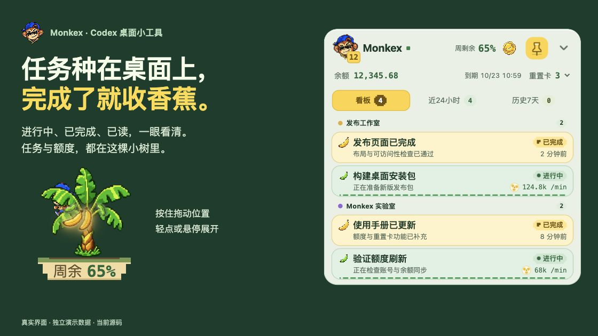
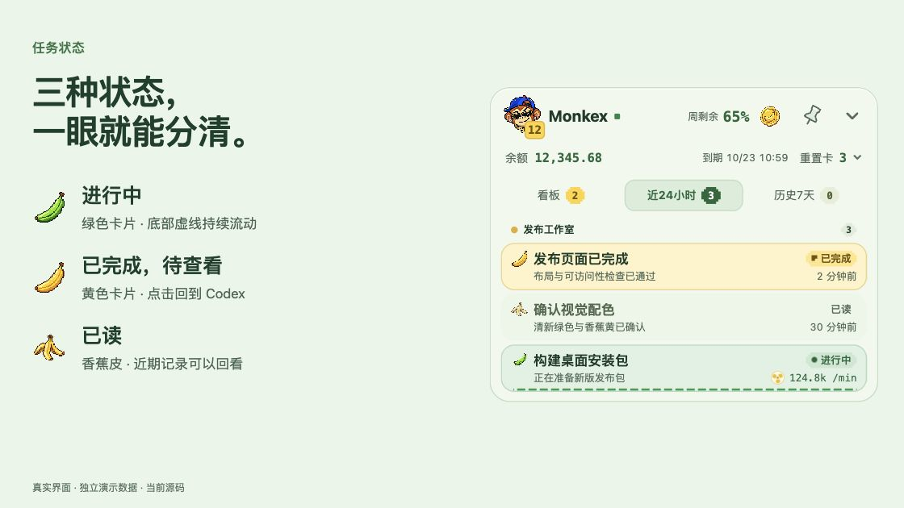
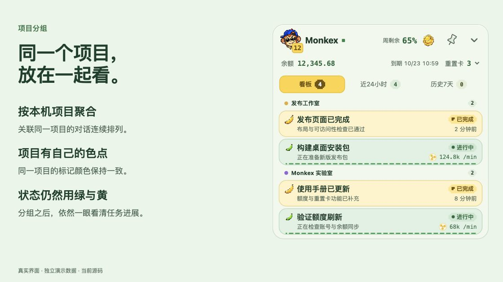
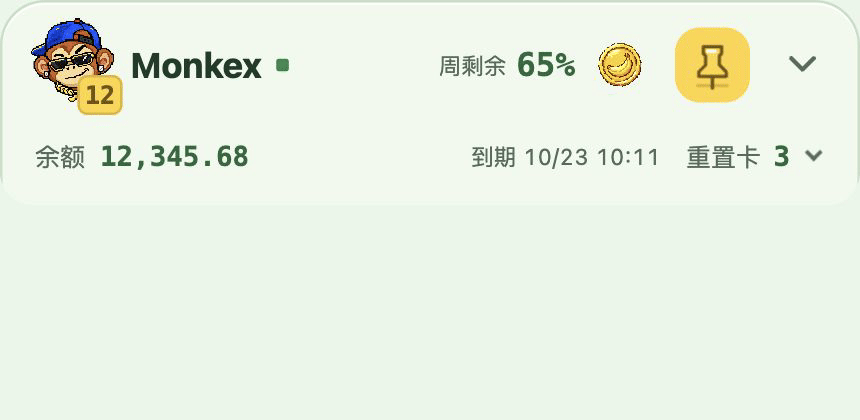
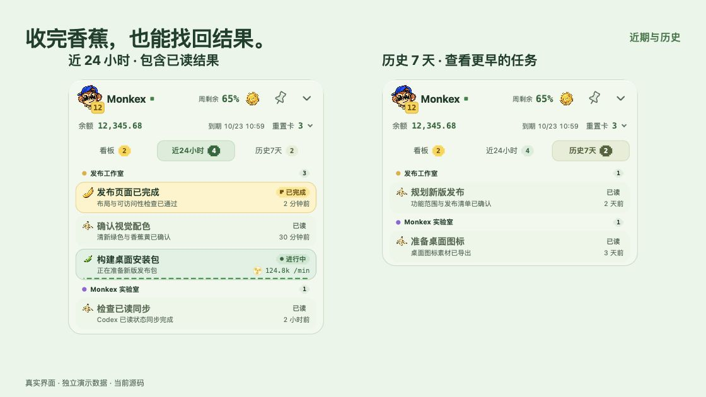

# Monkex · 把 Codex 任务种在桌面上

[English](README.en.md) · [下载预览版](https://github.com/zxzin/Monkex/releases) · [让 Codex 帮你安装](INSTALL_WITH_CODEX.md) · [交互手册](#先试试交互手册) · [反馈问题](https://github.com/zxzin/Monkex/issues)

Codex 在跑任务，桌面上的香蕉也在慢慢成熟。**绿香蕉表示进行中，黄香蕉表示完成待查看，读完就留下香蕉皮。** 打开 Monkex 看板，点一下任务，就能回到 Codex 原对话。

这是一个为 **Codex 桌面用户**做的小工具：把任务进展、未读结果和额度放在一棵像素香蕉树里。面向 macOS Apple Silicon 与 Windows x64，连接你自己的本机 Codex。独立开发，与 OpenAI 无隶属关系。

> **先看版本：** 下方展示当前 `main` 源码。公开安装包仍是 **v0.1.2 Preview（2026-09-09）**，尚未包含后续的英文界面、项目分组、悬停展开、近期 Codex 兼容修复和新增额度详情。最新功能需从源码构建；下载前请先查看[版本说明](#下载与版本)。核验日期：2026-10-22。

<p align="center">
  
</p>

<p align="center">真实界面 · 当前源码 · 所有任务和额度均为独立演示数据<br><a href="#看一眼就知道该收哪根香蕉">任务状态</a> · <a href="#多个项目放在一起看">项目分组</a> · <a href="#这次更新额度也能在桌面上看">额度详情</a> · <a href="#收完香蕉也能找回结果">近期与历史</a></p>

## 看一眼，就知道该收哪根香蕉



| 看到什么 | 代表什么 | 可以怎么做 |
| --- | --- | --- |
| 绿香蕉、绿色卡片、流动虚线 | 任务正在运行 | 扫一眼进展，继续手头的事 |
| 黄香蕉、黄色卡片、已完成标签 | 有新结果待查看 | 点击回到 Codex 原对话 |
| 香蕉皮、淡化的任务行 | 这份结果已经读过 | 在近 24 小时或历史 7 天中回看 |

- **一棵小树常驻桌面。** 按住树或花盆拖动，轻点或悬停展开。未固定时，鼠标移走或切到别的窗口会收起；图钉让面板保持展开。
- **读完结果，收一根香蕉。** 从看板打开并确认查看未读结果后触发收获反馈；头像角标累计本机自然周（周一至周日）的收蕉次数，重启保留。

## 多个项目，放在一起看



同一本机项目的任务连续排列，项目名旁的小色点保持一致。组内优先展示新完成的未读结果；卡片继续用绿色和黄色表达任务状态。项目色与状态色各有含义，多个对话同时运行也能分清。

## 这次更新：额度也能在桌面上看

<p align="center"></p>

<p align="center">6 秒循环 · 独立演示数据 · 只聚焦额度区 · <a href="docs/media/monkex-showcase-quota.zh.jpg">查看展开大图</a></p>

顶部保持紧凑，任务列表占主要空间：

| 信息 | 在哪里看 |
| --- | --- |
| 周剩余百分比 | 顶部常显，随余量从绿到黄到红；收起后花盆也会显示 |
| 周额度／5 小时额度重置时间 | 点击周剩余区域展开；5 小时窗口以 Codex 实际返回为准 |
| 额度余额 | 顶部下方的单行摘要，和订阅百分比分开显示 |
| 重置卡数量、最近到期时间 | 与余额共用一行，展开可看各批次有效期 |
| 任务和额度重新同步 | 点击香蕉金币，重新发现 Codex 程序并重建本地连接 |

时间按电脑本地时区显示。金币在观测到近期 Token 消耗时缓慢旋转，**一枚金币没有固定的 Token 或金额含义**。余额采用 Codex 返回的额度单位，Monkex 不估算“还剩多少 Token”，也不提供购买、充值或消耗重置卡的按钮。

新界面、连接恢复与数据边界的详细变更见 [CHANGELOG](CHANGELOG.md)。

## 收完香蕉，也能找回结果



「近 24 小时」包含近期已读结果；「历史 7 天」展示最后活动距今 24 小时以上、7 天以内的任务。上图是同一组合成任务的两种筛选视图，已读记录以香蕉皮区分，仍可点击回到原对话。

## 下载与版本

**先安装并登录 Codex 桌面应用，再安装 Monkex。** 普通安装包内置后端，无需 Python、Node.js 或 Rust。

| 你想做什么 | 对应入口 |
| --- | --- |
| 试用已发布的基础看板、收香蕉与周额度 | [v0.1.2 Preview 安装包](https://github.com/zxzin/Monkex/releases/tag/v0.1.2) |
| 使用动图中的新额度详情、分组、悬停和英文界面 | 当前 `main` 源码；[开发者构建](#开发者构建) |
| 先了解交互，暂时不安装 | [离线 HTML 手册](#先试试交互手册) |

v0.1.2 是较早的预览版。近期 Codex 程序发现与重连修复尚未进入该安装包，更新后的 Codex 可能无法被旧包识别。遇到连接问题，请先核对版本和[故障排查](docs/INSTALL.md)，保留已有任务与数据。

### 公开安装包

| 电脑 | 下载 v0.1.2 Preview | 安装方式 |
| --- | --- | --- |
| Mac · Apple Silicon（M 系列） | [Monkex-macOS-arm64.zip](https://github.com/zxzin/Monkex/releases/download/v0.1.2/Monkex-macOS-arm64.zip) | 解压，把完整的 Monkex.app 放入“应用程序” |
| Windows 10/11 · x64 | [Monkex-Windows-x64-setup.exe](https://github.com/zxzin/Monkex/releases/download/v0.1.2/Monkex-Windows-x64-setup.exe) | 双击安装；缺少 WebView2 时按安装器提示补齐 |
| Intel Mac / Windows ARM64 / Linux | 暂无对应安装包 | 先查看手册与源码 |

下载后核对同一 Release 的 [SHA256SUMS.txt](https://github.com/zxzin/Monkex/releases/download/v0.1.2/SHA256SUMS.txt)。macOS 包采用 ad-hoc 签名、未经过 Apple 公证；Windows 包没有发行者签名。系统可能提示风险，请核验来源后自行决定是否继续，保持系统安全保护开启。Windows 已通过 CI 安装与离线启动检查，真实已登录 Codex 的完整集成仍需真机验证。

### 把这段话发给 Codex

适用于拥有本机操作权限的 Codex。它会识别系统、核对公开包并协助安装，登录和系统安全确认由你完成。

```text
请帮我安装 Monkex：https://github.com/zxzin/Monkex 。
先读取 README、INSTALL_WITH_CODEX.md 和公开 Releases，识别本机系统及 CPU 架构。说明最新公开安装包与 main 源码的功能差异、Codex 兼容限制，再选择匹配的公开包并核验 SHA256。
保留现有用户数据，连接我自己的本机 Codex。不读取或上传凭据，不修改 Codex 配置或历史。没有匹配包或需要源码版新功能时，先说明选项，得到我明确同意后再构建。
遇到未签名／未公证、登录或管理员授权时先解释并让我确认，不关闭系统安全保护。
最后报告安装版本、路径、启动方法和实际验证结果。
```

[完整中英文安装提示词](INSTALL_WITH_CODEX.md) · [安装与故障排查](docs/INSTALL.md)

## 日常怎么用

1. **启动：** 打开 Codex 和 Monkex，香蕉树出现在主屏工作区右下角。
2. **看任务：** 轻点树展开。当前源码也支持悬停展开、移开收起；需要常看就按下图钉。
3. **收结果：** 在看板点一条已完成任务，回到 Codex 查看结果。新建任务、回复、审批和执行都留在 Codex。
4. **刷新或退出：** 点香蕉币同步任务和额度；右键桌面树选择“退出 Monkex”。运行时不占 macOS Dock 或 Windows 任务栏。

收香蕉动效默认开启，并遵循系统减少动态偏好。本周收成与动效是否播放无关，同一份结果仅累计一次。

## 先试试交互手册

[下载中文 HTML](https://github.com/zxzin/Monkex/raw/refs/heads/main/docs/guide.html) · [Download English HTML](https://github.com/zxzin/Monkex/raw/refs/heads/main/docs/guide.en.html)

保存后用浏览器打开即可。单文件内嵌图片、猴子动画与交互，支持离线浏览和手机排版，无需安装 Monkex 或登录 Codex。

11 个章节演示桌面树、任务状态、任务跳转、收香蕉、周额度、固定与退出等基础操作。手册使用独立示例数据；本次新增额度详情以本页动图与说明为准。GitHub 的 HTML 文件页展示源码，可使用 **Download raw file** 下载体验；当前未启用 GitHub Pages 在线托管。

## 常见问题

<details>
<summary>会额外消耗我的 Codex 额度吗？</summary>

看板读取 Codex 已有的任务标题、进展和用量信息，不额外发起模型生成请求。任务回复、审批和执行发生在 Codex 内。

</details>

<details>
<summary>切换账号、更新 Codex 后怎样恢复同步？</summary>

在包含最新连接修复的构建中，点击香蕉金币会重新发现 Codex 程序、重建连接并清空旧账号的额度快照。旧版 v0.1.2 不含全部后续兼容修复。手动设置过 `MONKEX_CODEX_PATH` 的用户，需要检查该路径是否仍有效。Codex 的接口和存储格式变化仍可能需要适配，完整步骤见[故障排查](docs/INSTALL.md#codex-更新后的恢复与验收)。

</details>

<details>
<summary>额度显示“—”，或者看不到某张卡的有效期？</summary>

破折号表示信息未知。只有 Codex 实际返回的信息才会展示；接口只给出重置卡总数时保留数量，并标记有效期待同步。临时失败最多保留 90 秒内的观测值并显示同步提示，过期后回到未知状态。

</details>

<details>
<summary>在 Codex 里读过的结果会同步吗？</summary>

当前源码会在支持的本机记录格式下同步 Codex 蓝点状态，自动同步不计入收蕉次数。未知格式、多账号歧义或结果版本变化时保留原状态。多个账号共用同一个系统用户历史目录时，Monkex 按本机目录读取，不按云账号隔离历史。

</details>

<details>
<summary>支持什么语言？会自动更新吗？</summary>

当前源码包含中文和英文界面，跟随系统／WebView 语言；任务标题保留原语言。公开 v0.1.2 包早于英文更新。Monkex 当前没有自动更新、开机自启或跨设备云同步。

</details>

反馈问题时，请附上 Monkex 版本、Release 标签或源码 commit、系统与架构、Codex 版本和复现步骤；截图先遮住任务内容、路径、账号与余额。请勿上传凭据或完整的私人任务日志。[提交 Issue](https://github.com/zxzin/Monkex/issues)

## 本机数据与边界

- 使用当前系统用户的 Codex 环境和已有 `CODEX_HOME`，无需作者账号或额外绑定。
- 本地后端仅监听 `127.0.0.1:8766`，读取任务元数据、近期上下文和运行记录；Monkex 已读记录与收蕉计数保存在系统应用数据目录。
- Monkex 自身没有分析埋点或远程上传服务；连接和登录由 Codex 管理。Codex 自身的联网行为遵循其设置。
- 安装包不包含作者的对话、训练资料或凭据。本页媒体全部采用独立演示数据。

## 开发者构建

源码版包含上方演示的新功能。构建需要 Python 3.11+、Node.js 22、Rust stable 与 [Tauri 平台依赖](https://v2.tauri.app/start/prerequisites/)。它适合愿意维护本机构建环境的开发者；安装提示词会先征得用户同意再走这条路径。

<details>
<summary>展开构建命令与兼容检查</summary>

```sh
python -m venv .venv
# 激活虚拟环境后：
python -m pip install pyinstaller==6.19.0
npm ci --prefix desktop_shell
python scripts/build_monkex_release.py
cd desktop_shell
npx tauri build --config src-tauri/tauri.release.conf.json --bundles nsis
# macOS 将 nsis 改为 app，回到仓库根目录后运行：
# python scripts/finalize_monkex_macos.py
```

构建脚本会生成中英文资源。macOS 流程包含嵌套代码签名与隔离后端测试；Python sidecar 当前保留有范围的 library-validation 例外，主 UI 保留校验。

已登录 Codex 后，在仓库根目录运行 `python scripts/check_codex_compatibility.py` 可只读检查初始化、任务列表和额度接口。脚本输出接口状态，不输出任务正文或凭据；仍应在实际桌面验证展开、刷新及任务跳转。

[英文构建说明](docs/monkex-guide/ENGLISH.md) · [更新记录](CHANGELOG.md)

</details>

## Rights

Copyright © 2026 Monkex contributors. Source-available; no general open-source license is granted. You may download and run released applications for personal use. Codex and OpenAI names belong to their respective owners. Character and coin artwork was generated with ImageGen.
